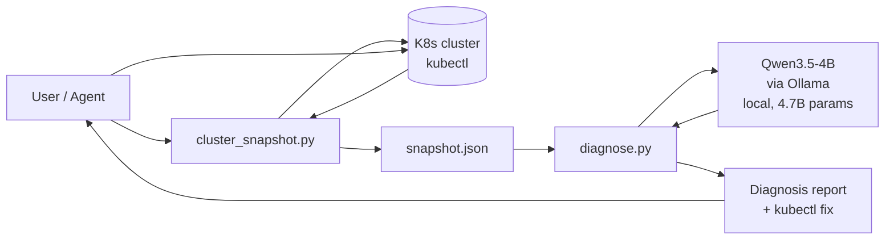
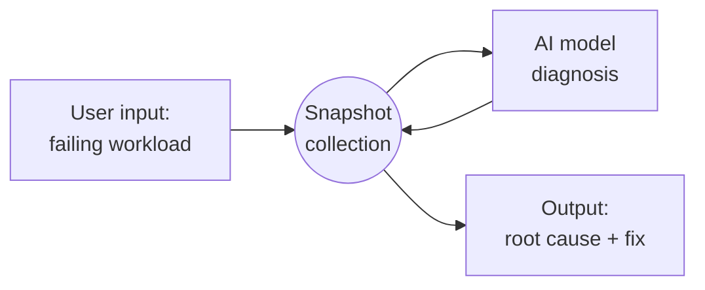
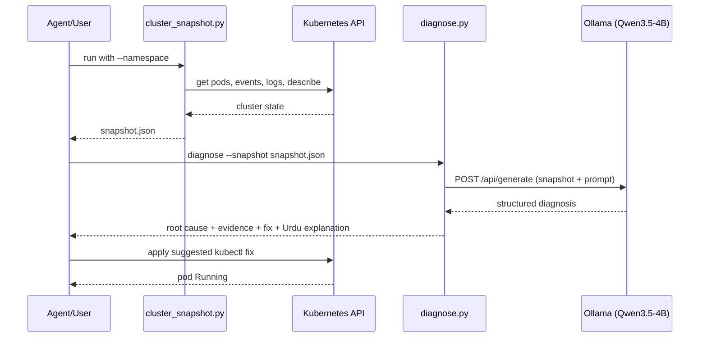

# ClusterMate

**An Agent Skill that gives any AI agent the ability to troubleshoot Kubernetes clusters, powered by a local open-weight model.**

Built for the Hacktoberfest Islamabad 2026 Open AI Build Challenge (Domain 03: Developer & Open Source).

## Problem

Debugging Kubernetes means correlating `kubectl describe` output, container logs, and cluster events across namespaces. Junior developers drown in it, and pasting cluster state into cloud AI tools leaks infrastructure details.

## Solution

ClusterMate is a skill pack following the **Agent Skills Open Standard** (`agentskills.io`): a `SKILL.md` with YAML frontmatter, bundled `scripts/`, `references/`, and `examples/`. Install it into any compatible agent (Claude Code, GitHub Copilot, OpenAI Codex, Gemini CLI) and the agent can:

1. Snapshot live cluster state (`scripts/cluster_snapshot.py` — stdlib only, needs just `kubectl`)
2. Diagnose it with a **local open-weight model** (`scripts/diagnose.py` via Ollama) — root cause, evidence, copy-paste `kubectl` fixes, plus a plain-Urdu explanation
3. Apply the fix and verify

## AI Component

- **Model (exact):** `qwen3.5:4b` — Qwen3.5-4B, **4.7 billion parameters** (within the event's 8B maximum), Apache-2.0 licensed open weights by Alibaba.
- **Runtime / provider:** Ollama, running locally on the build laptop (no cloud API, no API key).
- **Integration:** `scripts/diagnose.py` sends the JSON cluster snapshot to the model via Ollama's local HTTP API (`http://localhost:11434/api/generate`) and renders the structured diagnosis.
- **What it does:** the core reasoning — reading the snapshot, identifying the failure pattern, and writing the diagnosis, fix, and Urdu explanation. This is not a bolt-on: **remove the open-weight model and the project stops working entirely**.
- **Why local:** fully offline and private — cluster data never leaves the machine, no API keys, no cost, and the demo survives dead venue Wi-Fi.

## Architecture





Sequence (diagnose flow):



```
┌─────────────┐     kubectl      ┌──────────────────────┐
│  K8s cluster │ ──────────────▶ │ cluster_snapshot.py  │  snapshot.json
└─────────────┘                 └──────────────────────┘        │
        ▲                                                      ▼
        │ apply fix                              ┌──────────────────────┐
        └──────────────────────────────────────── │     diagnose.py      │
           agent (Claude Code /                │  local open-weight   │
           Copilot / Codex)                    │  model via Ollama    │
                  ▲                            └──────────────────────┘
                  │ install                           │
        skills/clustermate/SKILL.md ◀── references/common-failures.md
```

## Setup

```bash
# 1. Prerequisites: python3, kubectl pointed at a cluster, Ollama (https://ollama.com)
./setup.sh              # checks tools, pulls qwen3.5:4b

# 2. (Demo) start a local cluster and break something
kind create cluster
kubectl apply -f demo/broken-app.yaml

# 3. Install the skill (pick your agent)
cp -r skills/clustermate ~/.claude/skills/        # Claude Code
# or .github/skills/  (Copilot)  /  .agents/skills/  (Codex, Gemini CLI)

# 4. Run it
python3 skills/clustermate/scripts/cluster_snapshot.py -n clustermate-demo -o /tmp/snapshot.json
python3 skills/clustermate/scripts/diagnose.py --snapshot /tmp/snapshot.json
```

See `skills/clustermate/examples/example-session.md` for a full worked example and `demo/demo-script.md` for the 3-minute judging walkthrough.

## Testing and findings

Tested live during the build window against a local `kind` cluster.

Live run on 10 Oct 2026 against `kind-clustermate`, model `qwen3.5:4b` via local Ollama, CPU only (`size_vram: 0`).

| # | Test scenario | Input | Expected output | Actual outcome | Pass/Fail | Observed issues |
|---|---|---|---|---|---|---|
| 1 | Broken image tag | `demo/broken-app.yaml` (image `nginx:9.9.9-nonexistent`) | Diagnosis names ImagePullBackOff + bad tag; suggests `kubectl set image` | Pod `broken-web-6947985cb4-v9tb5` reached `ImagePullBackOff` (`docker.io/library/nginx:9.9.9-nonexistent: not found`). Diagnosis named that pod, the bad tag, and `ImagePullBackOff`, and suggested `kubectl set image deployment/broken-web ... -n clustermate-demo`. | Pass | The suggested command used placeholder `nginx:<correct-tag>` (examples `latest`, `1.25-alpine`), not a pinned good tag. First diagnosis attempt timed out at 10 minutes while Qwen was still thinking; re-run with thinking disabled finished in about 9.6 minutes. |
| 2 | Fix verification | `kubectl set image deployment/broken-web web=nginx:1.27 -n clustermate-demo` | Pod reaches `Running`; re-run snapshot shows 0 unhealthy pods | Rollout succeeded. Pod `broken-web-58f69d4c97-2mk87` is `1/1 Running`. Re-snapshot reported 0 unhealthy pods. | Pass | The applied tag came from the demo script. The model did not name `nginx:1.27` itself. |
| 3 | Offline run | Disconnect network, re-run `diagnose.py` | Full diagnosis with no internet | Not run in this pass. | Not run | Network stayed up so `nginx:1.27` could be pulled. |
| 4 | Security notes | Snapshot of the broken demo pod | Flags :latest tags, runAsRoot, missing memory limits | Report flagged the missing memory limit and explained a leak can take the node down. | Pass | This pod has neither a `:latest` tag nor `runAsRoot`, so those checks had nothing to flag. |
| 5 | HTML report | `diagnose.py --html report.html` | Styled report opens in browser | Opened in a browser. Summary, root cause, evidence, suggested fix, security observations, and the Urdu section are all present. Urdu renders as readable text. | Pass | Body text was invisible under the browser dark theme until the report CSS set a white background and dark text. Fenced shell commands render as plain paragraphs. Urdu is coherent, but the first sentence calls the image an انجینئر (engineer) before correctly calling it a تصویر. |

**Known limitations**
- Single-namespace snapshots are fastest; cluster-wide scans on large clusters are slower (tune `--max-pods`, `--tail`).
- The 4B model occasionally hedges on novel failures — the `references/common-failures.md` cheat-sheet grounds it on the common ones. On this run it identified the bad tag and the right `kubectl` verb, then left the replacement tag as a placeholder.
- CPU-only inference on this laptop took about 10 minutes per diagnosis with thinking disabled. With Qwen's thinking mode left on, the client hit its timeout before any report was written. Plan the demo around that, or pre-warm the model.
- The Urdu section is readable, not garbled. It still mixed one wrong word (engineer) into an otherwise correct explanation. A second model run was not spent on that wording.

## Demo

Live demo: deploy the intentionally broken app, snapshot, diagnose offline with the local model, show the Urdu explanation, apply the fix, watch the pod go green — under 3 minutes. Scripted in `demo/demo-script.md`.

## Team

- _Add your names and roles here_

## License

MIT — see [LICENSE](LICENSE).

## Acknowledgements

- [Ollama](https://ollama.com) — local model runtime
- [Qwen3.5](https://ollama.com/library/qwen3.5) — Apache-2.0 open-weight model by Alibaba
- [Kubernetes](https://kubernetes.io) — the thing we troubleshoot
- [Agent Skills](https://agentskills.io) — the open standard this skill complies with
